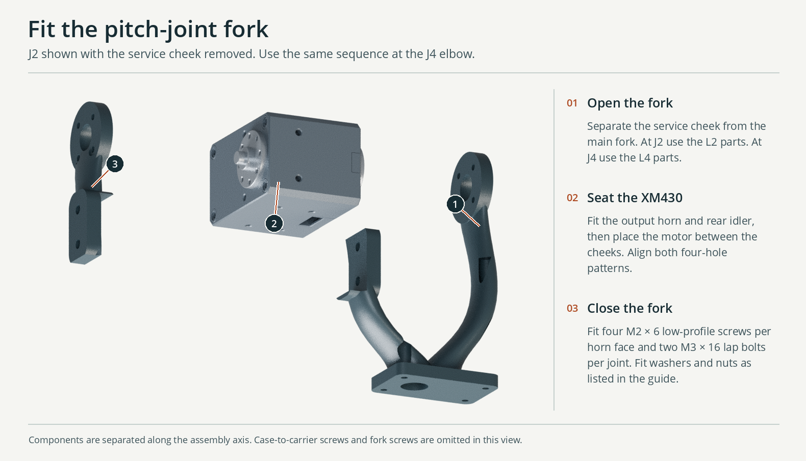
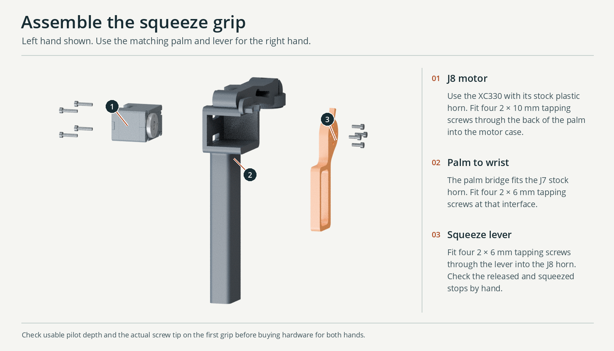

# Arm interfaces and purchased hardware

The new shoulder neck, two split pitch forks, two curved intermediate links and wrist saddle use the seven shaft lines of the scaled Hexfellow chain. The design uses round bearing and horn lands at the joints. Broad tapered sections run between the lands, with an open fork where an actuator needs support on both faces. A compact dogleg in the forearm allows the J6 and J7 axes to intersect without putting both actuator bodies at the intersection. All dimensions are millimetres.

| Joint | Actuator carried by | Drive and support in the arm |
|---|---|---|
| J1 | Torso shoulder module | Neck meets four M3 bores on a 24 mm pitch circle, with Ø9.3 central access. Motor and supported output cartridge are listed with the torso. |
| J2/J4 | Shoulder neck / upper bone | XM430-W210-T. Four case taps on the mounting side, with 24 × 12 mm spacing. Both sides of the moving fork attach to four horn/idler holes on a 16 mm pitch circle. One fork cheek detaches at a two-bolt lap. |
| J3/J5 | Upper fork / elbow fork | XC330-T288-T. Four holes at ±8 mm across the case and 30 mm apart down the body secure the rear. The output links use all four holes on the Ø12 horn pitch circle. The rear idler is omitted at these case mounts. |
| J6 | Forearm bone | XC330-T288-T with the same rear-case and horn interfaces. The shaft is shifted along its own line so the active face is at y = −20 in the arm frame. |
| J7 | Wrist saddle | XC330-T288-T. The palm takes motion from the front horn whose face is at [32.75, 0, 458.445], normal +X. Grip-side hardware is listed with the hand module. |

## Fastener schedule per arm

The receiving depth in a physical part determines the final screw length. Check those depths with actual motors and printer samples before buying bulk hardware. The crossing clearances in the assembly include modeled exposed arm screw heads and the two fork lap bolts on each pitch joint. Internal threads and the portions of short screws inside the actuator are omitted from visual geometry.

| Location | Count per arm | Nominal fastener and fit |
|---|---:|---|
| J2 and J4, fixed case | 8 | M2.5 × 7 machine screws with heads fitting the purchase guide’s envelope, through 4.3 mm mounting lands into the manufacturer’s 3.0 mm maximum-depth side taps. A 6 mm screw provides ~1.7 mm engagement if 7 mm cannot be sourced. |
| J2 and J4, fork to driving and idle horn | 16 | M2 × 6 low-profile screws; four per face on PCD 16. About 1.65 mm enters the M2 tap through the 4.35 mm cheek, below the published 2.0 mm maximum. Use heads ≤Ø4.2 by 1.5 mm, as modeled, or recheck the substituted head envelopes. |
| J2 and J4, removable cheek joints | 4 sets | M3 × 16 button-head bolt, two Ø7 × 0.5 mm washers, M3 low-profile prevailing-torque nut. Install the head on the case side and the nut outward. The double lap retains each cheek with two cross-bolts separated by 12 mm. |
| J3, J5, J6 and J7, fixed rear case attachment | 16 | Nominal 2 × 12 mm ROBOTIS-compatible plastic tapping screws, ≤Ø4.3 mm low-profile heads. The 4.2 mm printed mounting plate and the drawing’s 4.5 mm rear case entry leave about 3.3 mm of engagement in the smaller pilot. Test on the selected motor. The supplied horn screws serve a different length requirement. |
| J3, J5 and J6, output horn | 12 | Nominal 2 × 7 mm compatible tapping screws with ≤Ø4.3 × 1.7 mm head. Through 4.2 mm of plastic, this leaves ~2.8 mm for the Ø1.6 horn pilots, which allow 3 mm maximum. A 6 mm screw gives ~1.8 mm engagement. |
| J1 and grip interface | See module schedules | The other modules own their cartridge and J7 grip fasteners. |

Detach the service cheek before installing an XM430 in its fork. Fasten both horn faces and the two lap bolts after placing the installed actuator on the open fork half. The axial screw ports provide tool access in both directions. Install rear case screws on the XC330 mounts before fastening the downstream link to each horn. The outside cable chambers remain accessible. Each modeled insertion envelope extends 12 mm beyond the vendor case. Their rectangular shapes approximate connector servicing. Actual connectors, wires and service loops have to be dressed on a prototype.

The nominal exterior bodies, hole centers and mating faces come from the two ROBOTIS reference STEPs and drawings accessed through the e-manual. The static and rotating bodies of the X430 have been partitioned at the two measured concentric disk faces so the pitch-circle screw holes move with the fork.

- [XC330-T288-T ROBOTIS drawings](https://emanual.robotis.com/docs/en/dxl/x/xc330-t288/#drawings)
- [XM430-W210-T ROBOTIS drawings](https://emanual.robotis.com/docs/en/dxl/x/xm430-w210/#drawings)

## Assemble one arm

Start with the supported spindle and L1 neck installed. Support the arm on the bench and disconnect power. Compare the connectors and mounting faces to the left or right assembly before tightening. Each side uses the same L1–L6 links and its own handed palm and trigger. [Shoulder and L1 assembly](Shoulder_assembly.md) · [Installed quantities and head dimensions](Hardware_buying_guide.md) · [Left assembly STEP](../Assemblies/Left_leader.step) · [Right assembly STEP](../Assemblies/Right_leader.step)

| In order, once per arm | Which parts to join | Fasteners for this joint |
|---|---|---|
| J2 · shoulder pitch | Install the XM430 in L1. Mount the L2 upper fork and its matching service cheek on the drive horn and rear idler. | 4 × M2.5 × 7 at the case, 4 × M2 × 6 per horn face, 2 × M3 × 16 lap bolts. |
| J3 · upper-arm roll | Fasten the XC330 rear case to L2. Seat the L3 upper bone on the stock plastic horn. | 4 × 2 × 12 at the case, 4 × 2 × 7 at the horn, all plastic tapping. |
| J4 · elbow pitch | Mount the XM430 on L3. Fit the L4 elbow fork and its matching service cheek. | Same installation and quantities as J2. |
| J5 · forearm roll | Fit the XC330 rear case to L4 and the dogleg L5 forearm bone to the horn. Align its bend with the assembly view. | 4 × 2 × 12 at the case, 4 × 2 × 7 at the horn, all plastic tapping. |
| J6 · wrist pitch | Fit the XC330 rear case to L5 and seat the L6 wrist saddle on the horn. | 4 × 2 × 12 at the case, 4 × 2 × 7 at the horn, all plastic tapping. |
| J7 · wrist roll | Fit the XC330 rear case to L6. Seat the matching palm’s circular register over the stock plastic horn. | 4 × 2 × 12 at the case, 4 × 2 × 6 at the palm, all plastic tapping. |
| J8 · trigger | Seat the XC330 in the handed palm with its connector accessible. Index the matching lever at the released stop and attach it to the stock horn. | 4 × 2 × 10 through the palm wall into the rear case, 4 × 2 × 6 through the lever into the front horn, all plastic tapping. |

**At J2 and J4**, install the factory drive-horn retainer and rear idler before closing the fork. Seat the open fork on the motor, offer up the detachable cheek and start all eight perimeter screws loosely. Seat the two lap bolts with the button heads toward the motor, one Ø7 × 0.5 washer on each side and a low-profile M3 locking nut outward. Bring the faces down evenly. Check the motor turns freely, the nuts engage their locking elements and the tips clear the motor throughout the intended motion. Use the maker’s drawing for any factory spacer rings on the purchased case. [ROBOTIS XM430 assembly](https://emanual.robotis.com/docs/en/dxl/x/xm430-w210/#how-to-assemble)

**At each XC330**, retain the stock plastic horn with its factory center screw before covering it with the next link. Install rear-case screws first. Measure each tapping screw’s projection through the printed land and compare it with the receiving depth. Start by hand with the screw square to the hole. The rear case, front horn and center retainer each take different hardware. [XC330 drawing](https://emanual.robotis.com/docs/en/dxl/x/xc330-t288/#drawings) · [Grip hardware and fit](FACTR_grip.md)

**Check the assembled side.** With its weight supported and power disconnected, move each joint a short distance in both directions. Verify that the case stays fixed, the intended link moves, the shoulder turns freely and each trigger reaches both molded stops. Dress the cables, then repeat with the wrist turned and elbow bent. At the table, test the documented two-stage park-to-working motion slowly before trying a two-hand reach. A straight interpolation between those parked and working angles produced grip collisions in CAD. The project has not been physically commissioned on a Hexfellow. [Tested poses and known collisions](../Checks/Collision_and_workspace.md) · [Gravity and actuator limits](../Checks/Gravity_and_actuators.md)

## Nominal local checks

OpenCascade tested 3,333 eligible component-pair and joint-angle combinations. The largest common solid volume rounded to 0.00000 mm³. Of these comparisons, 70 tested fixed attachments and 1,230 involved the 12 mm connector insertion envelopes. The sampled rotations included the limits of each follower joint. J2 through J7 used 21, 33, 20, 33, 11 and 11 positions, respectively. Both handed palms were included where they meet the wrist. These local tests cover print-to-actuator and print-to-print interfaces and the external fastener envelopes. They cannot establish full-motion clearance of every flexible wire, wrist posture or operator hand. See `Checks/Arm_joint_interfaces.csv` for the tested pairs.
