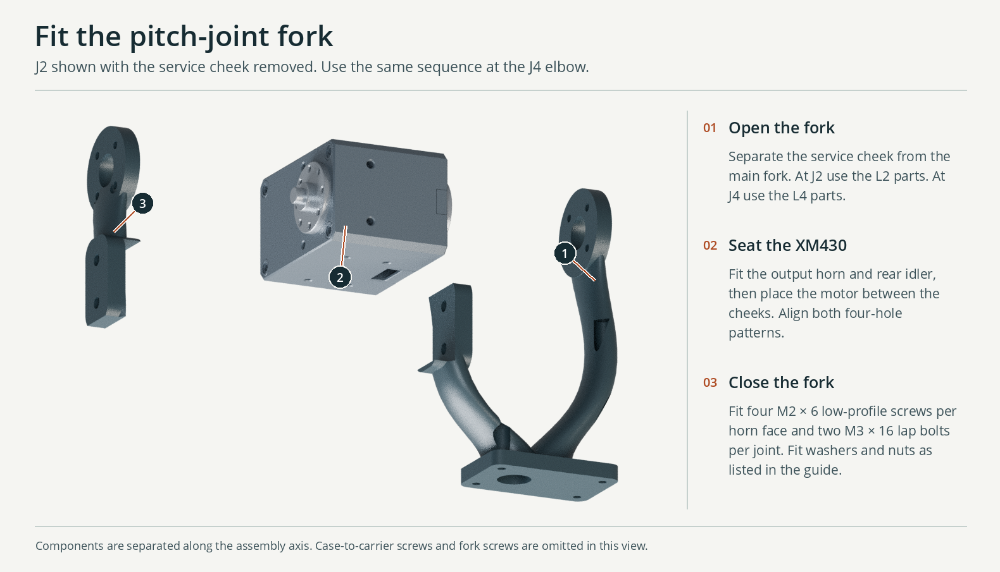
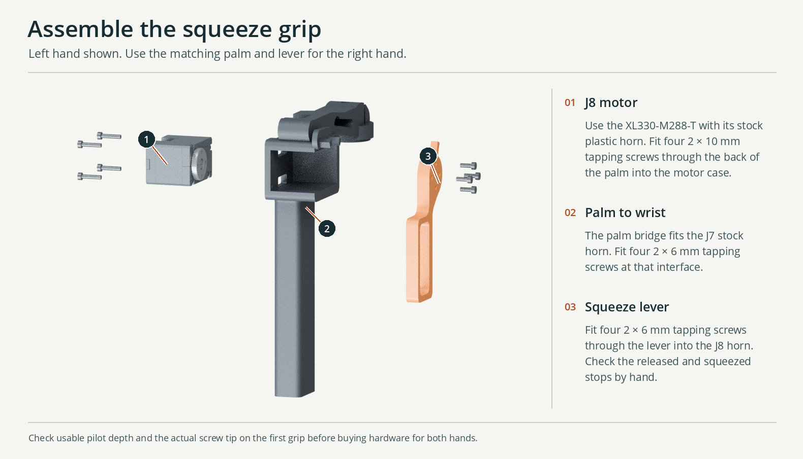

# Assemble the arms and grips

The J2 and J4 pitch joints use XM430 motors with a driven horn on one face and an idler on the other. A split printed fork supports both faces. J3, J5, J6, J7 and the trigger use XL330-M288-T motors with stock plastic horns. Both sides use identical drums, saddles and L2–L6 links. The palms and triggers are handed. Use the matching side STEP for the motor orientation, cable outlets and neutral horn clocking. [Left arm](../Assemblies/Left_leader.step) · [Right arm](../Assemblies/Right_leader.step) · [Buying guide and head dimensions](Hardware_buying_guide.md)

## Install one side from the shoulder outward

Support the arm and disconnect motor power. Begin with the J1 faceplate, J2 motor and saddle installed. The four J2 case screws are accessible while the saddle is detached. If the J2 case is loose or missing, complete that subassembly first. [External shoulder sequence](Shoulder_assembly.md)

| Joint | Where to attach the case | Where to attach the moving part | Per joint, per side |
|---|---|---|---|
| J1 · external shoulder drum | Fixed drum on F01 | Round faceplate to HN12-N101, keyed J2 saddle onto faceplate | 4 M4 × 14 to torso, 4 M2.5 × 7 socket caps to case, 4 M2 × 6 socket caps to horn, 3 M3 × 10 into captive M3 nuts. |
| J2 · shoulder pitch | J2 XM430 to loose saddle, before attaching saddle to plate | L2 upper fork and L2 service cheek to horn/idler | 4 M2.5 × 7 pan heads to case, 4 low-head M2 × 6 per horn/idler face, 2 M3 × 16 fork lap bolts. |
| J3 · upper-arm roll | XL330 rear case to L2 | L3 upper bone to stock horn | 4 plastic taps 2 × 10 at case, 4 plastic taps 2 × 7 at horn. |
| J4 · elbow pitch | XM430 to L3 upper bone | L4 elbow fork and L4 service cheek to horn/idler | Same screw groups and quantities as J2. |
| J5 · forearm roll | XL330 rear case to L4 | L5 curved forearm bone to horn | 4 plastic taps 2 × 10 at case, 4 plastic taps 2 × 7 at horn. Follow the handed assembly view for the dogleg orientation. |
| J6 · wrist pitch | XL330 rear case to L5 | L6 wrist saddle to horn | 4 plastic taps 2 × 10 at case, 4 plastic taps 2 × 7 at horn. |
| J7 · wrist roll | XL330 rear case to L6 | Matching palm's circular register to horn | 4 plastic taps 2 × 10 at case, 4 plastic taps 2 × 6 through palm. |
| J8 · trigger | XL330 rear case to handed palm | Matching trigger to horn, indexed at its released stop | 4 plastic taps 2 × 10 at case, 4 plastic taps 2 × 6 through lever. |

## Small servo fit on the upper fork

The main J2 fork has two motor interfaces. At the round end, its cheeks seat on the J2 XM430's horn and idler. At the flat end, the **back of the small J3 XL330-M288-T** sits on a rectangular pad. The production pad is **3.00 mm thick** at the screw seats, down from 4.20 mm. Its footprint is 24 × 37.5 mm. Its four holes form a 16 × 30 mm rectangle. Material comes off the screw-head side so the case sits at the same position. For this fit change, reprint the main fork. The separate J2 service cheek fits the same XM430. [Upper-fork STL](../Parts/Printable_STL/L2_Upper_fork.stl) · [Upper-fork STEP](../Parts/Printable_STEP/L2_Upper_fork.step)

1. Place the unpowered motor against the pad with the driven horn facing the next link. Leave the driven horn installed. The optional Ø16 mm rear idler stands 3 mm proud of the case and catches on the pad's Ø9.3 mm center opening. Omit the rear idler so the bare rear case seats flush by hand.
2. Seat one **2 × 10 mm plastic tapping screw** in the loose print. Measure from the case-contact face to its tip. A 10 mm screw through 3.00 mm of print projects **7.00 mm**. The 4.50 mm clearance entrance in the motor leaves **2.50 mm nominal tip reach** into the narrow pilot. Check the actual pilot depth and the supplied screw profile before fastening it.
3. Fit four matching screws by hand with the motor supported. A supplied 2 × 8 mm frame screw reaches only 0.50 mm into the pilot. The old 2 × 12 mm screw would reach 4.50 mm into the pilot and could bottom in the case. If the case rocks, identify the interference before tightening.

The same 3.00 mm rear-case pad applies at J5 on the L4 elbow fork, J6 on the L5 forearm bone and J7 on the L6 wrist saddle. The J8 pocket in the palm already has a 3.00 mm rear mounting wall. The **4.35 mm** round cheeks at the XM430s and the **4.20 mm** J3/J5/J6 driven-horn seats have their own fasteners. [Measured STEP pad thicknesses](../Checks/Export_readback.txt) · [Full hardware list](Hardware_buying_guide.md)

## Close each XM430 pitch fork

1. Seat the fixed case against its printed pad and reach the four case screws with the joint still accessible. At J2 these install from the back of the loose saddle. At J4 install the case on L3 before adding the L4 fork. The four holes are on a 24 × 12 mm rectangle. A 7 mm screw through the 4.3 mm land leaves 2.7 mm inside the motor against a 3.0 mm maximum.
2. Fit the HN12-N101 drive horn with its OEM center screw and thrust washer. Fit the HN12-I101 idler, plastic bearing and DC12 cap on the other side. Follow the indexing marks and the factory procedure. [ROBOTIS horn and idler instructions](https://emanual.robotis.com/docs/en/dxl/x/xm430-w210/#how-to-assemble)
3. Separate the loose service cheek from the fork, seat the main half on its face and bring up the matching cheek. Start four **M2 × 0.4 × 6 low heads per face** on the Ø16 pitch circle. Each passes a 4.35 mm cheek, reaching 1.65 mm into a 2.0 mm maximum tap. Keep both fork faces parallel as the screws start.
4. Close the lap with **two M3 × 0.5 × 16 button-head bolts**. Put the head toward the case and the low locking nut outward. Use one Ø3.2 × Ø7 × 0.5 washer at **each** end. Bring the two cheeks down evenly. Check the screw tips extend through the locking element and clear the case when the joint moves. Seat the eight horn screws evenly and turn the fork by hand with its weight supported.

## Attach the XL330s and hands

1. Fit each rear case to its printed land first. Each uses four screws on the rear case pattern, 16 × 30 mm center-to-center. Check screw projection through the actual print and measure the available pilot depth. The first 4.5 mm of the rear case opening is larger than the deeper pilot. Inspect head seating, plug access and the cable exit before adding the next link.
2. Align and retain the stock plastic horn with its factory center screw. Then mount the next link using four taps on the Ø12 pitch circle. Start each by hand and use the compatible tapping profile verified against a supplied screw. At J3, J5 and J6 the 2 × 7 through a 4.2 mm print projects 2.8 mm into a 3.0 mm maximum horn. A blunt machine screw and a pointed plastic tap of the same nominal diameter have different receiving interfaces. [Motor drawing](https://emanual.robotis.com/docs/en/dxl/x/xl330-m288/#drawings) · [Tapping screw selection](Hardware_buying_guide.md)
3. Fit the palm at J7 with four 2 × 6 taps. Fit J8 into the palm with four 2 × 10 rear screws and the lever with four 2 × 6. Verify the lever reaches both molded stops with the weight supported and torque disabled. The CAD travel is 0° to 30°. Check physical travel and each hand's encoder sign before mapping trigger travel to the follower gripper. [Grip hardware and stops](FACTR_grip.md)

## Fit the harness and check travel

Allow a real service loop at each rotating interface. Connect data between the eight motor IDs on each side. Keep motor supply pins isolated where the chain crosses between the XM430 supply and the regulated 5 V XL330 supply at J2–J3, J3–J4 and J4–J5. A stock three-wire TTL cable carries supply voltage as well as data. [Power domains and wiring](Hardware_buying_guide.md#power-and-ttl-wiring)

With power disconnected, support the hand and move one joint at a time. Look for connectors pulled sideways, a lead caught in the J1 seam, screw heads rubbing and interference between grippers. Repeat with wrist rotation and elbow bend. During initial powered commissioning keep the follower disabled, identify each motor, verify encoder direction and set a supported rest position. The documented two-stage approach avoids the known grip collision on a direct park-to-working interpolation. Other poses hit the frame. [Station collision results](../Checks/Collision_and_workspace.md) · [Gravity and release behavior](../Checks/Gravity_and_actuators.md)

The distal-interface CAD checks sample individual joint angles, fixed attachments and idealized 12 mm connector access envelopes. The J1 direct-drive faceplate and J2 saddle have a separate set of checks. Cable bends, clips, printed tolerances and hand clearances need physical verification. [Joint interface and connector checks](../Checks/Arm_joint_interfaces.csv) · [Fork assembly clearances](../Checks/Arm_assembly_clearances.csv) · [External shoulder checks](../Checks/Shoulder_interfaces.md)
