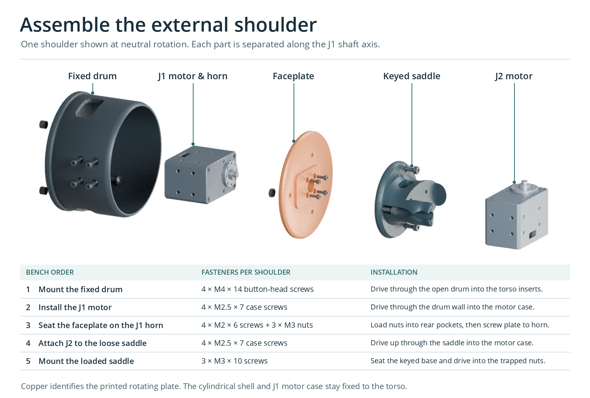
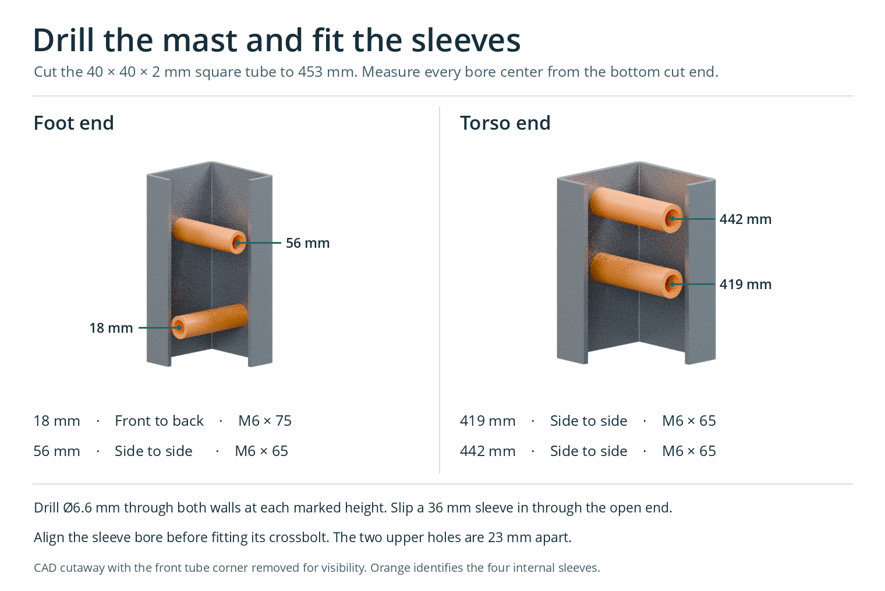

# Assemble the external-drum shoulder

Each side has three shoulder prints. **The drum stays fixed to the torso. The round faceplate turns with the J1 horn. The swept saddle carries the J2 motor.** Build the first side with its arm supported and the power disconnected. Both shoulders use the same parts. The complete assembly STEP shows their opposite installed orientations. [Whole station](../Assemblies/Bimanual_leader.step) · [Hardware buying guide](Hardware_buying_guide.md)

## Lay out one shoulder

| From torso toward arm | Pieces on the bench | Fasteners for this connection |
|---|---|---|
| Chest to fixed drum | 1 drum, 4 short brass M4 inserts in F01 | 4 × M4 × 0.7 × 14 unflanged button |
| Fixed drum to J1 motor case | 1 XM430-W210-T | 4 × M2.5 × 0.45 × 7 socket cap |
| J1 output shaft to horn | 1 HN12-N101, factory thrust washer | 1 factory WB M2.5 × 6 |
| Horn to rotating faceplate | 1 faceplate | 4 × M2 × 0.4 × 6 socket cap |
| J2 motor case to loose saddle | 1 XM430-W210-T, 1 swept saddle | 4 × M2.5 × 0.45 × 7 **pan head** |
| Saddle to faceplate | 3 plain DIN 934 M3 nuts, 5.5 AF × 2.4 tall | 3 × M3 × 0.5 × 10 socket cap |

Bring calipers, a depth gauge, a square, a Ø6.6 drill and alignment pin, a deburring tool, an insert-setting tip, 10 mm wrench and thin-wall socket, straight 1.5, 2 and 2.5 mm hex keys and a narrow long-reach driver for the J2 pan heads. The example low-head fork screw takes a separate 1.3 mm hex key. Dry-fit the keys through the prints before starting. Leave powered drivers off these small motor threads.

## Prepare the stand

1. Cut the 40 × 40 × 2 square tube to **453 mm**. Deburr, check its corner radii against both sockets and mark one end **bottom**. The mast bottom sits 8 mm above the tabletop on the foot floor. Use the lower **cut end of the tube** as the drilling datum.
2. Mark the centerline of the correct face for each row below. Drill the Ø6.6 hole through both opposing walls. Verify the holes against the actual foot and collar before final assembly.
3. Prepare four aluminum sleeves, Ø10 outside × Ø6.6 bore × 36 long. Deburr the ends, check each fits between the actual inside faces and feed it in through the nearest open end. Hold a sleeve across its hole with an alignment pin while fitting the print, then replace the pin with the bolt. Temporary tape can hold a sleeve inside the post during insertion. Keep the bore and bearing faces clear. Repeat for each crossbolt.
4. Bolt F02 flat to the bench. Use four M6 through-bolts on a 100 × 102 rectangle, one Ø12 × 1.6 washer under each head, one beneath the bench/backer, and a plain M6 nut. The [buying guide](Hardware_buying_guide.md) gives the length calculation. Slip the post into the foot and seat it on the floor. Slide the chest collar onto the top with the shoulder shaft line forward of the post.
5. Insert the four crossbolts with one Ø12 × 1.6 washer under each head and nut. A bolt should pass the aligned print, both tube walls and sleeve by hand. Confirm the sleeve spans the walls before tightening. Check all four foot corners sit down and the collar stays square.

| Hole from tube bottom | Direction in assembled stand | Bolt and destination |
|---:|---|---|
| 18 mm | Fore–aft | M6 × 1.0 × 75, lower foot |
| 56 mm | Left–right | M6 × 1.0 × 65, upper foot |
| 419 mm | Left–right | M6 × 1.0 × 65, lower torso collar |
| 442 mm | Left–right | M6 × 1.0 × 65, upper torso collar |

The upper two bolts pass through 56 mm between print seats. Two 1.6 mm washers and the 5 mm nut leave 0.8 mm nominal protrusion. Inspect full thread engagement at the far nut. If actual hardware is thicker, choose the next usable length and check the exposed tip. In the assembled STEP the upper hole centers sit 427 and 450 mm above the table.

## Install the fixed drum and J1 motor

1. Test one short M4 insert in a coupon printed in the same material and orientation. Heat-set **four RX-M4Sx4.0 inserts** into one round end of F01 from the outboard face. Use the specified Ø5.6 × 7.4 pockets. Keep the brass flush and square. Let the plastic cool and inspect the thin outer wall for cracking or bulging. A trial M4 screw should enter and withdraw without moving the insert. [ruthex short insert](https://www.ruthex.de/en/products/ruthex-gewindeeinsatz-m4s-50-stuck-rx-m4x4-0-short-messing-gewindebuchsen-fur-3d-druck)
2. Present the **empty** drum, flat flange against the torso, open circular mouth facing out toward the arm. Orient the four small motor-case holes in the rearward wall and align the cable passage with the opening through the chest. Check this clocking against the station STEP. Feed the torso-side cable while both ends are accessible.
3. Looking into the open mouth, insert four **M4 × 14 button heads** through the drum floor on the Ø70 diagonal bolt circle. Seat in a crossing pattern. The 8.5 mm floor leaves 5.5 mm of projection, passing the 4 mm insert by 1.5 into relief. Confirm the flange is held flush before covering it with the motor.
4. Install the J1 HN12-N101 with its factory thrust washer and WB M2.5 × 6 center retainer using the manufacturer's alignment marks. Confirm the intended encoder index. Slide the unplugged motor **in from the arm side**, horn outward, until the case's four threaded end holes align with the rectangular pattern in the drum wall. The Ø16 horn bolt circle will remain visible from the front. [ROBOTIS normal horn assembly](https://emanual.robotis.com/docs/en/dxl/x/xm430-w210/#normal-horn-assembly)
5. Insert the four **M2.5 × 7 socket caps** from outside the drum wall, radially into the motor end. The 4.3 mm printed seat leaves 2.7 mm in each nominal 3.0 mm maximum case tap. Measure through the actual print. Connect and check access to both J1 leads through the side windows while the face is open. Keep the eventual moving loop out of the circular rim.

## Fit the faceplate and its three captive nuts

1. Identify the faces of the loose plate. The **three hex pockets open toward the torso**. The shallow, rounded rectangular locating boss faces the arm. Insert a plain M3 nut in each pocket from the torso side, turning it until the flats seat. The nut should lie flat, 5.5 mm across flats and 2.4 mm high. A fork locknut is too tall. Trial-thread a saddle screw to confirm each nut aligns and stays against its seat. Remove the trial screw. A swept solid 5.5 AF hexagon cleared all three insertion paths in the nominal plate from its open side to the 57.0 mm axial seat. Check the actual print for shrinkage at the corners.
2. Keep the nuts seated as you turn the plate and bring it to the horn. If the fit is loose, hold the nuts at their flats with a removable assembly aid, keeping the threads clear. Alternatively assemble the loose chest over bench blocks with the shoulder facing down and room underneath for the tools. Gravity then holds the nuts against the closed ends of their pockets as you raise the plate onto the horn. Account for all three nuts and remove any temporary aid before turning the joint. A loose nut inside the drum can jam the mechanism.
3. Put the faceplate boss outward, the central Ø10.2 relief over the horn-center head, and the four small bores on the diagonal Ø16 horn pattern. The vendor STEP includes a Ø8 center envelope projecting 4.7 mm from the horn face. The WB M2.5 × 6 retainer and its thrust washer are not separately resolved there. Verify that your installed head and washer clear the Ø10.2 opening and the saddle underside, and that the plate bears flat on the horn. Clock the plate to match the arm's starting position. A full Ø3.8 × 2.0 head envelope cleared both the faceplate and saddle at each of the four screw positions in nominal CAD. Attach the plate with four **M2 × 6 socket caps** from the outboard face, using the 1.5 mm key. Each screw seats through 4.2 mm of print and enters the horn by 1.8 mm, against a 2.0 mm maximum. Check the actual under-head length and projection with the loose print. Tighten evenly and verify that the bare plate follows the servo with clearance from the fixed rim.

## Mount the J2 motor before attaching its saddle

1. Set J2 in the **detached** swept saddle. Match the case face and cable connector to the relief in the CAD. J2's output and idler axes run transversely to the J1 output. Offer each **M2.5 × 7 pan head** through the back of the saddle. Use the four straight access bores to drive the screws into the motor case. This approach is covered once the saddle sits on the faceplate. Check nominal projection of 2.7 through the 4.3 mounting land.
2. Install the factory J2 drive horn and center hardware, and the HN12-I101 rear idler and matched cap. Support the motor and bring the assembly straight onto the rounded rectangular register on the J1 faceplate. Align the J2 cable lead with the open relief and check the motor does not bottom on the cable or its connector. [ROBOTIS XM430 horn and idler assembly](https://emanual.robotis.com/docs/en/dxl/x/xm430-w210/#how-to-assemble)
3. Start the three **M3 × 10 socket caps** from the arm side around J2. A Ø3.1 × 74 straight driver envelope cleared each path in CAD with the J2 case, horn and idler present. Use a straight 2.5 mm hex key through the access channels to engage the three rear-loaded nuts. Start all three by hand before seating. The saddle must sit flat on the locating face. In CAD each screw passes the back of its nut by 1.6 mm. Check the ends clear the fixed drum as the joint turns.
4. Support J2 and move J1 gently by hand. Confirm the motor case and drum stay fixed, the faceplate and saddle turn together, and wires stay free of the rim. Check for rocking at the horn, skipping at the nut seats, and edges that close on a cable. Fit L2 and the rest of the chain using the [arm assembly guide](Arm_interfaces.md). Repeat on the opposite side.
5. With the completed arms supported and the follower disabled, verify the joint indices, mirrored directions, trigger endpoints and cable slack. Bring up the intended working route one joint at a time. The supplied checks identify torso, mast and grip contact on other trajectories. Full-range motion and force feedback still require a wired prototype. [Checked poses and collision examples](../Checks/Collision_and_workspace.md)

For service, support the arm, disconnect power, release the three saddle screws and hold the module as it comes off the register. The four J1 horn screws are now accessible. Catch the three loose nuts when removing the faceplate. Unplug the J1 cable and withdraw the motor from the open end after removing its four radial case screws.
