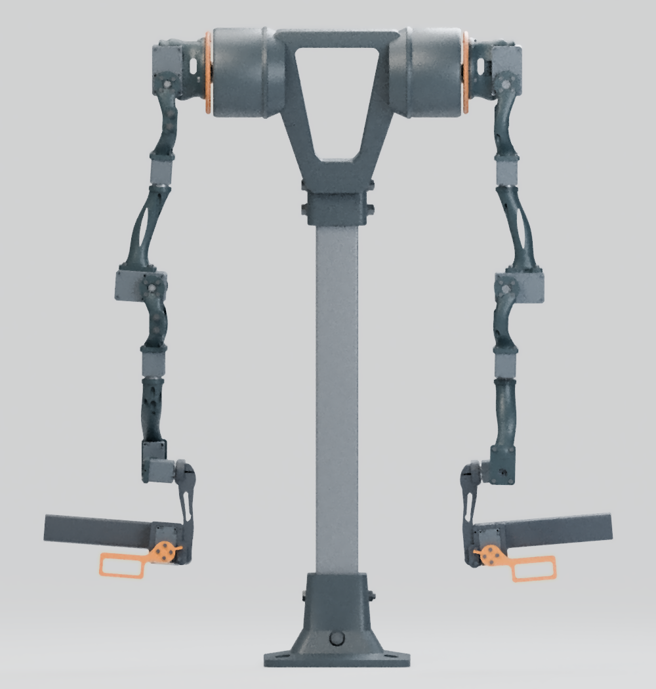
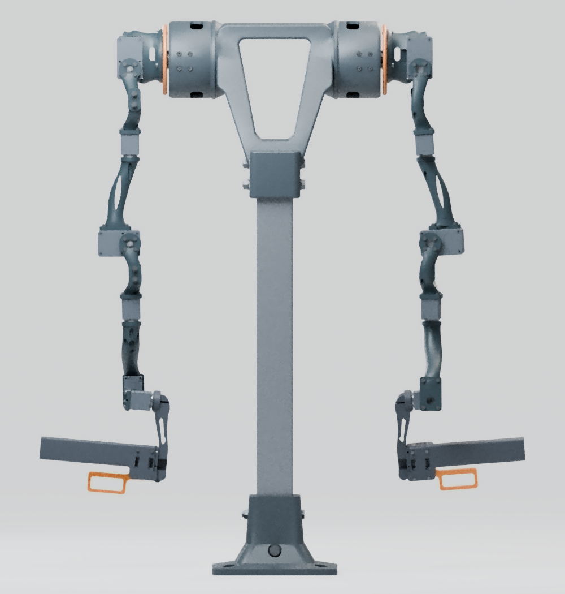
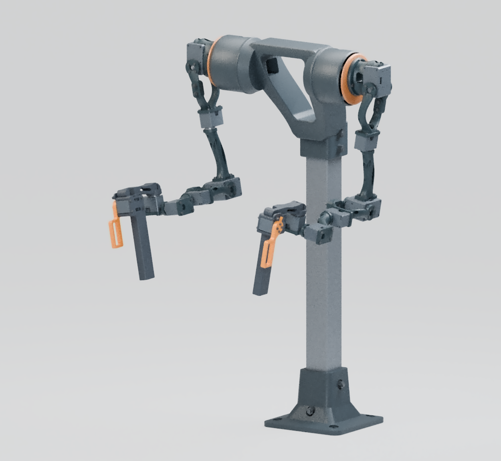
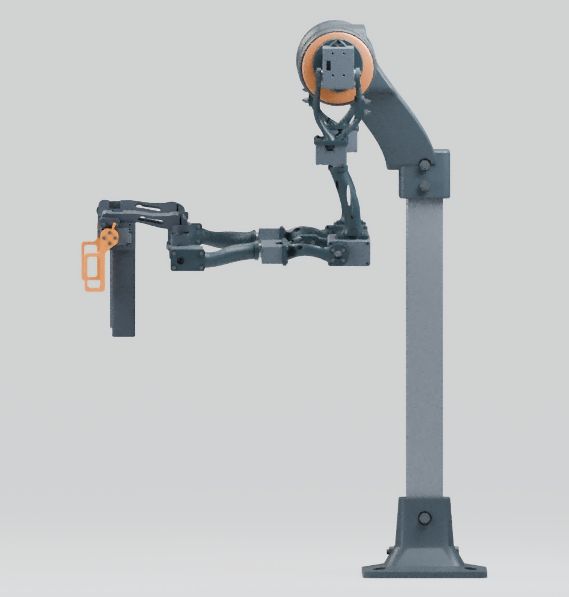
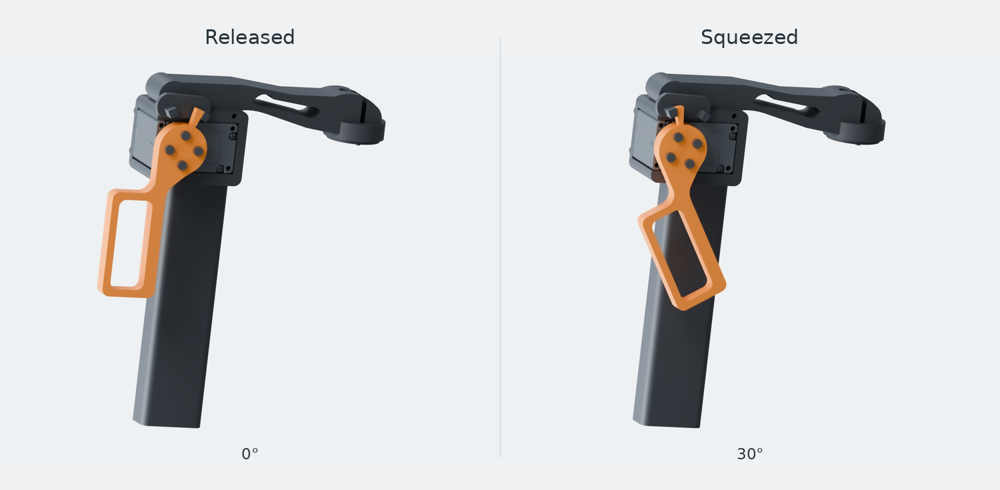

# Hexfellow teleoperation leader

I’m working on reproducing FACTR 2’s force-feedback experiments on the Hexfellow MAVER X4 and exploring which manipulation tasks benefit from contact feedback. This repository contains the mechanical design for the two-handed leader. Each arm has seven joints and a finger trigger for the follower’s GP80 gripper. The arm geometry and shoulder spacing follow the Hexfellow model at 65% scale.

| Front | Rear |
| --- | --- |
|  |  |

| Three-quarter view | Side view |
| --- | --- |
|  |  |

## Build the external-drum version

1. **Inspect the assembly.** Open the full STEP in Fusion or FreeCAD. The torso carries a fixed external drum on each side. An XM430 sits in the drum and turns a faceplate on its factory horn. The next shoulder motor bolts into a removable curved saddle on that plate. [Full bimanual STEP](Assemblies/Bimanual_leader.step) · [Poseable FreeCAD model](Assemblies/Poseable_leader.FCStd)
2. **Order and fabricate the parts.** One station uses 6 XM430-W210-T and 10 XC330-T288-T motors, 26 printed pieces from 16 files, one drilled square aluminum mast and four metal crush sleeves. The buying guide gives installed quantities, screw lengths, head clearances and motor-kit contents. The quantity table identifies the handed palm and trigger prints. [Hardware buying guide](Design/Hardware_buying_guide.md) · [Print and metal quantities](Design/CAD_parts_and_quantities.csv) · [Print files](Parts/Printable_STL/) · [Metal drawings in STEP](Parts/Metal/)
3. **Assemble the stand and one shoulder.** Drill the mast from its bottom datum. Install the case, cable, factory horn and captive faceplate nuts in the illustrated order while the driver still has access. Check the rotating faceplate by hand before loading it with an arm. [Illustrated shoulder and mast assembly](Design/Shoulder_assembly.md) · [Frame and mounting dimensions](Design/Frame_and_shoulder.md)
4. **Fit the arm and grip.** Assemble J2 through J7, then fasten the J8 motor inside the palm. The J8 case takes four 2 × 10 mm plastic tapping screws per hand. Its trigger takes four 2 × 6 mm screws. Support the arm for the first motion check. [Arm installation and screw locations](Design/Arm_interfaces.md) · [Grip assembly and trigger travel](Design/FACTR_grip.md)

## What the CAD checks establish

The model preserves the follower’s seven shaft lines per arm after scaling. The shoulder mounting faces are 130 mm apart. The shoulder-to-elbow and elbow-to-wrist spans are 192.075 mm and 171.925 mm. The CAD includes 101 component occurrences, with some fasteners grouped in a single occurrence. [Hexfellow geometry](Checks/Hexfellow_geometry.md) · [Export readback](Checks/Export_readback.txt)

At J1 the rotating faceplate clears the fixed drum rim by **1.50 mm** in the unloaded model. The XM430 output supports the arm through the horn. On the first assembled shoulder, check how much that gap closes under the weight of the arm and a hand on the grip. [Shoulder measurements and tool access](Checks/Shoulder_interfaces.md)

The working pose, five two-hand paths and a two-stage move from the hanging pose cleared the sampled interference checks. **11 of 395 sampled configurations showed collisions**, including a direct move between the hanging and working poses. The report identifies which parts touch. A physical build still needs checks for cable sweep, finger clearance, shoulder deflection and motor temperature under the intended duty. [Tested motions and collisions](Checks/Collision_and_workspace.md) · [Gravity and actuator estimates](Checks/Gravity_and_actuators.md)

The motor layout in these files is **three XM430s per side at J1, J2 and J4**. The remaining four arm joints and the trigger use XC330s. A hand-supported leader can relax the requirement to hold a pose when released. A smaller elbow motor would still need a different J4 mount and a test of the feedback it can produce. Powered teleoperation, encoder calibration and force reflection are project milestones.

[Opening and posing the model](START_HERE.md) · [Editable CAD and rebuild instructions](CAD_Source/README.txt) · [FACTR, Hexfellow and ROBOTIS references](Design/Sources.md)

If you already printed parts for the earlier bearing-cartridge shoulder, use its matching assembly, mast and hardware instructions. [Earlier bearing-cartridge revision](https://github.com/RenoZhao19/Hexfellow-Teleop-Leader-Arm-Design/tree/6f87a52b8fcfbeb0d12691ee3ce5d856a338f359)
